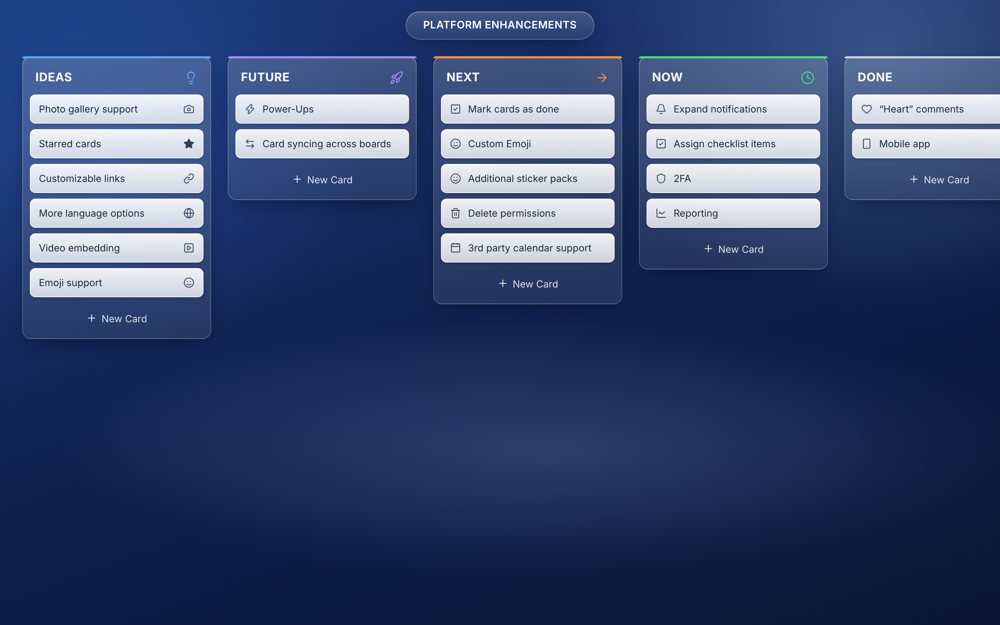
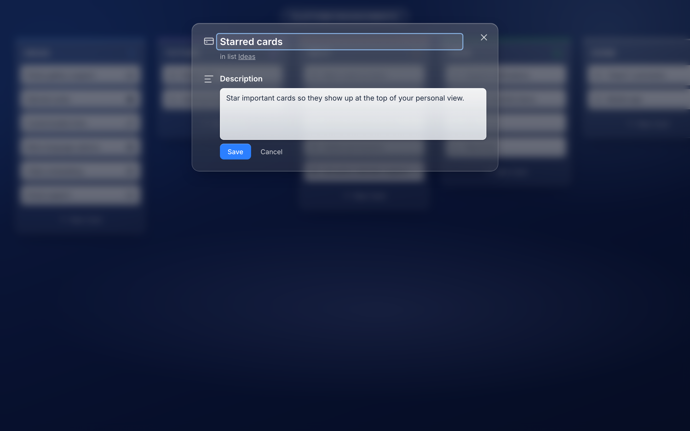
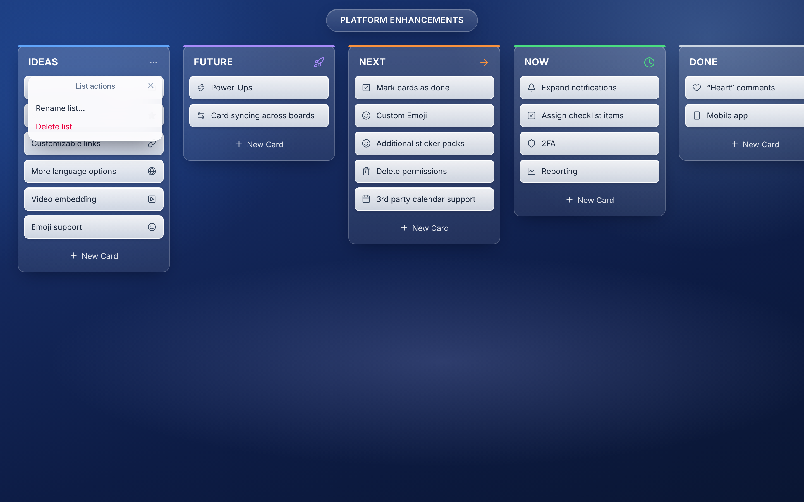
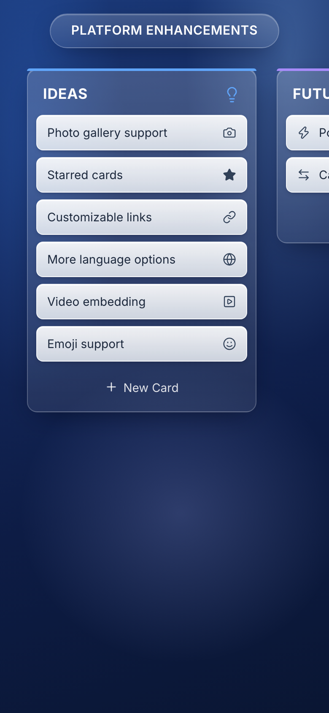
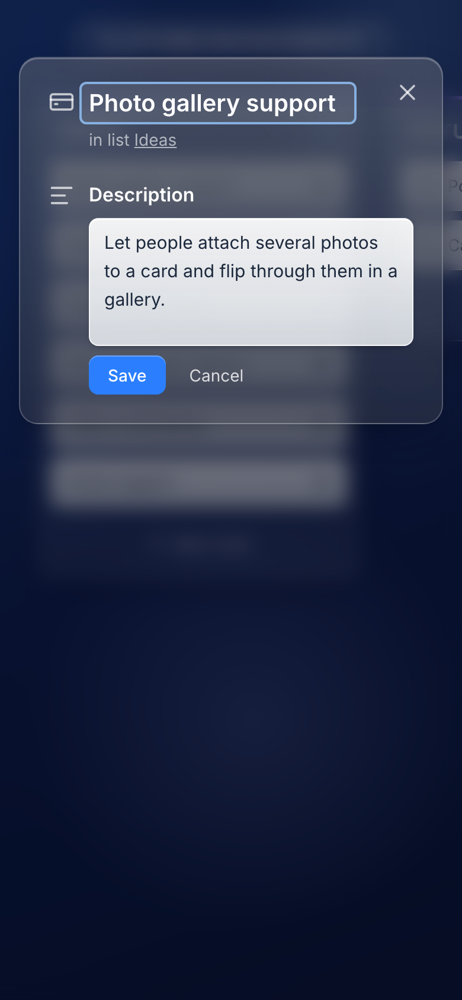

# Kanban — mobile-first spec, ready for Capacitor

> One React codebase, two deliverables: a **website** and a **real app installed on an iPhone**.
> No Xcode on the Mac, free Apple ID only, nothing paid.
> The reference is the desktop kanban app from the previous video (screenshots below). This spec
> rebuilds it **phone first**; the desktop layout becomes the wide-screen variant of the same app.

---

## 1 · What the app does (from the reference)

| Feature | Reference behaviour | Screenshot |
|---|---|---|
| Board | One board, title pill at the top ("Platform Enhancements"), frosted-glass lists on a dark blue gradient | `01-desktop-board.png` |
| Lists | Ideas · Future · Next · Now · Done. Each has a colored strip on top, an icon top-right, and its own accent color | `01` |
| Cards | Title + one icon. Tap opens the card | `01` |
| Card editor | Edit title + description, Save / Cancel, shows "in list X" | `02-desktop-card-editor.png` |
| Add card | "+ New Card" at the bottom of each list → text field + "Add card" | `04-desktop-add-card.png` |
| Rename list | Click the list title → inline edit, Enter saves, Esc cancels | `03-desktop-rename-list.png` |
| List actions | "…" menu → Rename list, Delete list (deletes its cards too) | `03b-desktop-list-actions.png` |
| Add list | "+" button after the last list → "New list" | `01` |
| Delete card | Trash icon on hover | — |
| Drag and drop | Cards between and within lists; whole lists sideways | — |
| Persistence | Saved on every change, survives a refresh. Seed board on first start | — |

## 2 · Why it can't just be shrunk — the reference on a phone today

- Lists are 272 px wide side by side → one and a bit lists visible, the rest is a horizontal scroll with no sense of where you are
- **Hover-only controls don't exist on touch:** the card trash icon and the list "…" button are invisible until hover
- Mouse drag-and-drop fights with scrolling on touch
- Small tap targets (the "…" button is 32 px, the trash icon ~26 px)
- The editor is a floating dialog; on a phone it should be a sheet, and the keyboard must not cover Save

---

## 3 · Mobile-first design

> Layout target: iPhone portrait, 390 × 844. Everything works with a thumb. Same glass look and colors as the reference.

- **One list per screen.** Lists sit side by side with horizontal **scroll-snap**; swipe left/right to change list
- **List switcher** at the top: a row of pills (list name + accent dot), the active one highlighted; tap jumps to that list. Replaces the board title pill on phone
- **Cards full width**, min height 52 px, title + icon as in the reference
- **Tap a card → bottom sheet** (full width, slides up): title, description, "in list X", **Move to…** (list picker), **Delete** (red, with confirm). Save stays above the keyboard
- **Moving cards on touch:**
  - primary: **Move to…** in the sheet: always works and is easy to film
  - secondary: **long-press (≈300 ms) then drag** to reorder within a list or drop onto a list pill. Scrolling must keep working when there's no long-press
- **List menu "…" always visible** (no hover). Sheet with Rename list, Delete list (confirm)
- **Add card:** a sticky "+ New Card" at the bottom of the active list; opens the keyboard directly
- **Add list:** last pill in the switcher is "+"
- **Tap targets ≥ 44 px**, no hover-dependent UI anywhere
- **Safe areas:** respect `env(safe-area-inset-*)` (notch, home indicator); `viewport-fit=cover`
- **No rubber-band zoom:** `maximum-scale=1`, inputs at ≥16 px font so iOS doesn't zoom on focus
- **Wide screens (≥ 900 px):** fall back to the reference layout: all lists side by side, mouse drag-and-drop, hover controls allowed *in addition to* the always-visible ones

## 4 · Capacitor-friendly from the first line

> These rules make the web build drop into Capacitor without rewrites.

- **Static build only.** Vite outputs `dist/`; Capacitor's `webDir` is `dist`. No server, no SSR, no API routes
- **Relative asset paths** (`base: './'`), so it loads from `capacitor://localhost` as well as from the web host
- **Client-side routing with `HashRouter`** or a router whose fallback works without a server (deep links resolve in-app)
- **Storage: IndexedDB via `idb-keyval`**, not `localStorage` (iOS can evict WebView localStorage). One key per board; load is async, so show the seed only after the load resolves
- **No browser-only APIs without a check:** `crypto.randomUUID` is fine; `window.open`, file pickers, and notifications go through a Capacitor plugin later or are skipped
- **Native plugins are opt-in.** Each one (e.g. `@capacitor/haptics` for a buzz on drop) needs a fresh native build. List them here before adding them
- **Dev loop on the phone:** `capacitor.config.ts` `server.url` → the Mac's LAN IP + Vite dev server for hot reload, behind an env flag, **off** for real builds
- **Debugging:** Safari Web Inspector over the cable, not Xcode
- **One binary, room for more apps:** routes are nested (`/kanban/*`), lazy-loaded, so a second app (`/meals/*`) can live in the same install. A free Apple ID allows only 3 sideloaded apps
- **Deep links:** custom scheme only (`flo://kanban/card/<id>`) via `@capacitor/app` `appUrlOpen` + `getLaunchUrl` for cold starts. Universal Links need a paid account, so they're out

## 5 · Stack

- React + Vite + TypeScript, Tailwind for the glass look, `lucide-react` icons (same names as the reference)
- Capacitor for the iOS shell
- Drag and drop: a touch-capable library (e.g. `@dnd-kit` with a long-press activation constraint)
- Website: same repo, `dist/` deployed to Vercel (or any static host)

## 6 · From laptop to iPhone (no Xcode, free)

1. **Run it locally:** `pnpm dev`, check it at phone size in the browser
2. **Make it an app:** `npx cap add ios`, `npx cap sync ios`
3. **Build on GitHub:** a workflow on the `macos-15` runner (pinned, not `macos-latest`) builds an **unsigned** `.ipa` with `CODE_SIGNING_ALLOWED=NO`. Trigger: `workflow_dispatch` only, never on push. Repo public, so the macOS minutes are free
4. **Install:** download the `.ipa` artifact, open it in **SideStore** on the iPhone, which signs it with your Apple ID and refreshes it before the 7-day expiry
5. **Website:** the same `dist/` goes to Vercel

> **Expect red CI runs.** Failures can't be reproduced without Xcode, so each fix is one more
> push-and-wait cycle. The usual suspects: the scheme name, CocoaPods, the iOS deployment target.
> Your results can look different from mine, or not work the first time. That's normal.

> **Prove the chain first:** before building the kanban app, push a page that only says "hello"
> through steps 2–4. The one unverified assumption is that SideStore accepts the unsigned `.ipa`.
> Find that out with "hello", not with a half-built app.

## 7 · Done when

- [ ] All features from §1 work on the phone with touch only
- [ ] Board survives closing and reopening the app
- [ ] Installed from SideStore, opens from the home screen, no browser bar
- [ ] The same build is live as a website
- [ ] Wide screen still looks like the reference

## 8 · Later, not now

- OTA updates with Capgo
- Sync between phone and website (needs a backend)
- Android (`npx cap add android`)

## Watch for drift

- Asking for a native plugin? It needs a fresh CI build, so flag it
- If the app ends up as only a webview pointing at a URL with no native plugins, it's a PWA, and the Capacitor setup isn't earning its keep. Say so
